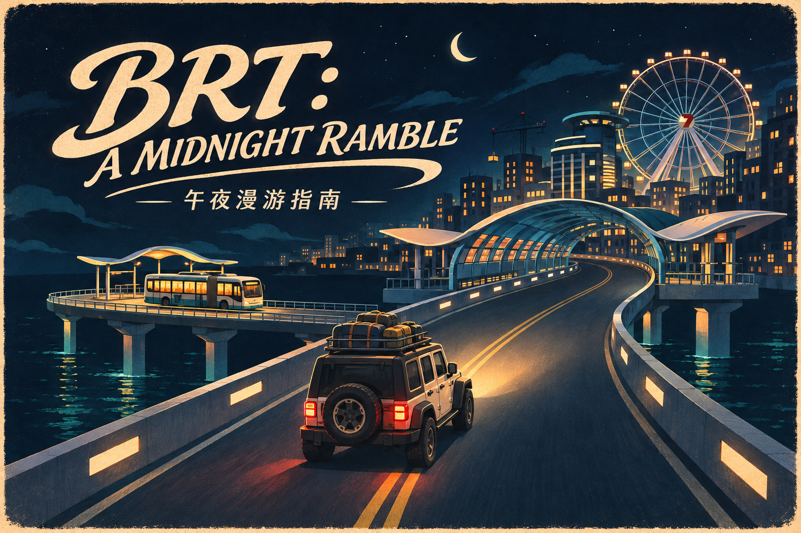
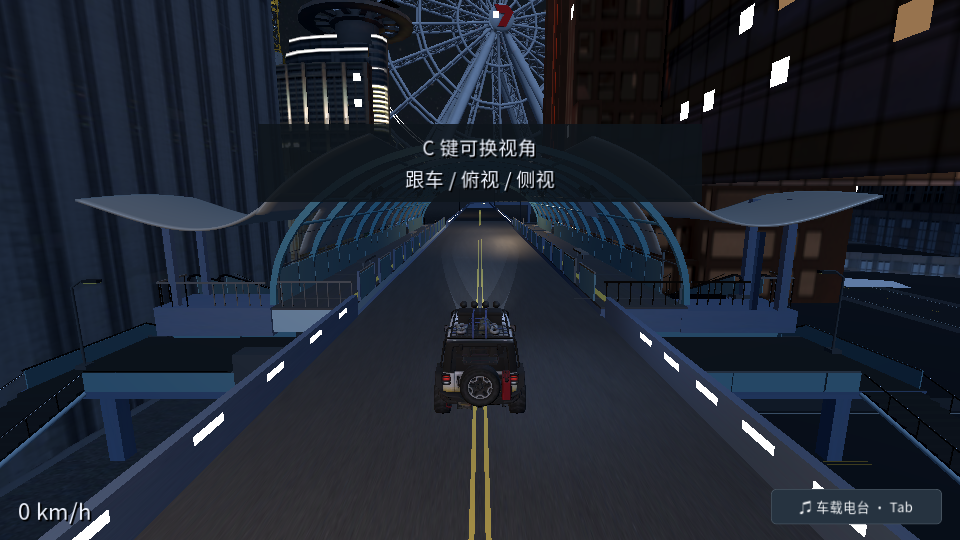
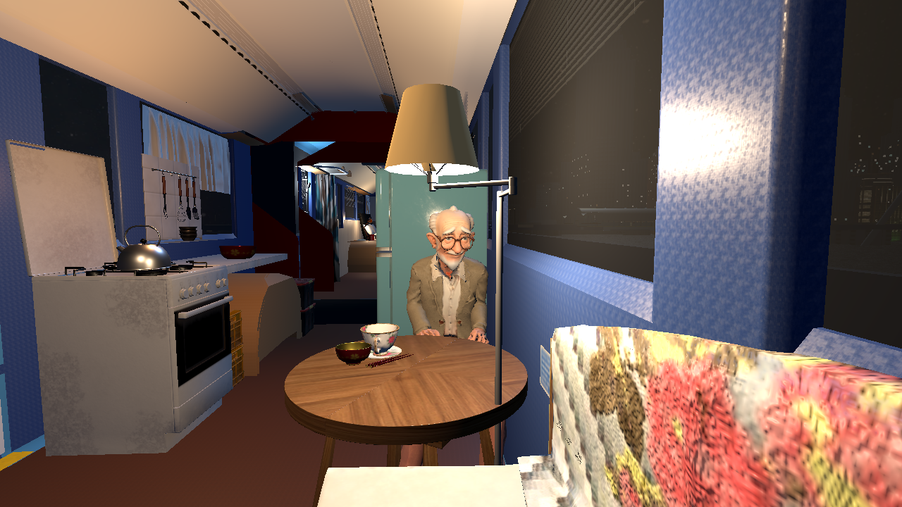
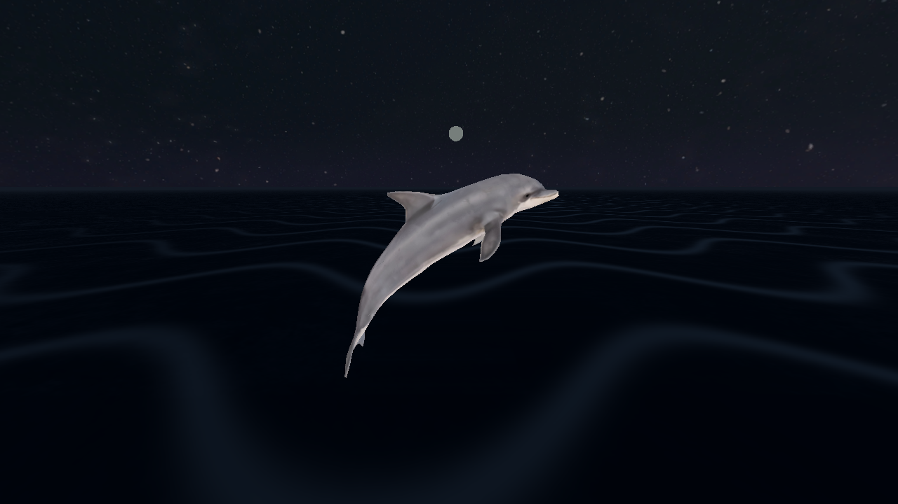

# BRT: A Midnight Ramble / BRT：午夜漫游指南

**Season One · Free · Windows 64-bit · Keyboard & mouse · Chinese dialogue and interface**

**第一季 · 免费 · Windows 64 位 · 键盘与鼠标 · 中文界面与对话**

[**Download on itch.io / 在 itch.io 免费下载**](https://yyystudio.itch.io/brt-a-midnight-ramble) · [**GitHub Releases / GitHub 备用下载**](https://github.com/liangliang2049/brt-a-midnight-ramble/releases/latest) · [**Feedback / 问题与建议**](https://github.com/liangliang2049/brt-a-midnight-ramble/issues)

## About the game / 游戏介绍

Take a midnight drive along an empty BRT route, and discover that the city still has a few surprises waiting for you.

Drive above the streets, stop to explore, meet unexpected companions, and photograph the moments you want to remember. A crane might carry you somewhere you never meant to go. A bus by the sea might turn out to be somebody’s home.

This is a slightly absurd, comforting adventure. The gameplay is simple; more than anything, it’s a journey, one unexpected stop at a time.

在午夜无人的 BRT 车道上开车，看看这座城市还有什么意想不到的事情。

驶过高架，停下来探索，遇见奇妙的同行者，也拍下想留下的风景。吊机可能把你送到从未想过的地方，海边的一辆巴士，也可能是某个人的家。

这是一个有些离谱、又有些治愈的冒险。游戏本身并不复杂，更多地像一场旅行：一站，又一站。

> The game is currently available in Chinese only. The English introduction on this page does not indicate an English game translation. The current build is for Windows 64-bit; a macOS build is not included.
>
> 游戏目前仅提供中文界面与对话。此页提供英文介绍，游戏暂未提供英文翻译。目前的下载包仅适用于 Windows 64 位，尚不包含 macOS 版本。

## Download & play / 下载与启动

1. Download the Windows ZIP from [itch.io](https://yyystudio.itch.io/brt-a-midnight-ramble) or [GitHub Releases](https://github.com/liangliang2049/brt-a-midnight-ramble/releases/latest).
2. Extract the **entire ZIP** into a folder.
3. Run **开始游戏.cmd** (Start Game). Keep the accompanying files together. Godot does not need to be installed.

1. 从 [itch.io](https://yyystudio.itch.io/brt-a-midnight-ramble) 或 [GitHub Releases](https://github.com/liangliang2049/brt-a-midnight-ramble/releases/latest) 下载 Windows 分享包。
2. **完整解压 ZIP** 后，运行 **开始游戏.cmd**。
3. 请保留全部配套文件，无需安装 Godot。

For GitHub downloads, choose **BRT_A_Midnight_Ramble_Season_One_Windows_v134.zip** under the release’s Assets. GitHub’s automatically generated “Source code” archives contain this showcase repository and are not the playable game.

在 GitHub 下载时，请选择发行版 Assets 下的 **BRT_A_Midnight_Ramble_Season_One_Windows_v134.zip**。GitHub 自动生成的 “Source code” 压缩包是此展示仓库的内容，不是可玩的游戏。

Already downloaded v133? A small **v133-to-v134 patch** is available in the [v134 release](https://github.com/liangliang2049/brt-a-midnight-ramble/releases/tag/v134), so you do not need to download the full game again.

已下载完整 v133 的玩家，可以在 [v134 发行页](https://github.com/liangliang2049/brt-a-midnight-ramble/releases/tag/v134) 选择小补丁，按安装说明更新，无需重下整个游戏。

## In-game screenshots / 实机截图

The cover is a promotional illustration. The images in this section are screenshots from the game.

封面为宣传插画；本节图片为游戏实机截图。

## A note from the creator / 制作缘起

I’m a middle-aged woman who runs a little pork-rib hotpot restaurant. Making a game was never something I imagined I would do.

But I’ve always loved the BRT (Bus Rapid Transit) system in the city I call home. I’ve also always been drawn to the informal little spaces of everyday life—the places that aren’t grand or official, but feel alive. Somehow, those loves became this slightly absurd, comforting game.

On an empty BRT route at midnight, you’ll encounter one unexpected stop after another. The game itself isn’t complicated. It’s more like taking a trip.

I’m Liangliang of YYY Studio, and this is my second game. Thank you to my AI partner, Duke, for helping make this possibility real, and for all the work on the technical side that brought it to life.

I hope you enjoy the journey. And if you have thoughts, suggestions, or advice to share, I’d be very grateful!

— Liangliang, YYY Studio

一个从未想过会制作游戏的人，一个开着一家小排骨火锅店的中年女人，一直钟爱着她所居住的城市的 BRT，也一直钟爱日常生活里的非正式场景，于是有了这样一个离谱又治愈的游戏。

在午夜无人的 BRT 车道上，经历一站又一站的奇遇。游戏本身并不复杂，更多地像一场旅行。

这是来自 YYY Studio 的靓靓的第二个游戏。谢谢我的 AI 伙伴 Duke，让这种可能性成为现实，也谢谢它在各项工程实现方面的工作。

希望大家可以喜欢这个游戏。如果您不吝赐教，那就太感激啦！

—— 靓靓，YYY Studio

## Feedback / 欢迎反馈

Tell us which station you were at, what you were doing, and what happened. A screenshot and the game version (currently **v134**) are helpful. Please leave passwords and personal save data out of public reports.

欢迎在 [Issues](https://github.com/liangliang2049/brt-a-midnight-ramble/issues) 留下建议或问题。遇到 bug 时，告诉我们所在站点、当时的操作和发生的情况；附上截图及游戏版本（当前为 **v134**）会更方便定位。

## Credits & AI / 鸣谢与 AI

Created by **Liangliang / 靓靓 · YYY Studio**, with engineering assistance from **Duke**, an AI coding partner. The promotional cover illustration was AI-generated. Existing third-party notices are included in the game package’s `game/licenses/` folder.

本游戏由 **靓靓 · YYY Studio** 创作，AI 编程伙伴 **Duke** 协助代码与工程实现。宣传封面插画使用了 AI 生成。已有的第三方鸣谢与许可记录随游戏包放在 `game/licenses/` 中。

This is the public release, showcase, and feedback repository. It contains documentation and promotional images. The Godot/Blender project files and source assets are not included; publication here does not relicense third-party materials.

这是游戏的公开发行、展示与反馈仓库，收录说明和宣传图片，不包含 Godot / Blender 工程或源素材，也不对第三方素材重新授权。
